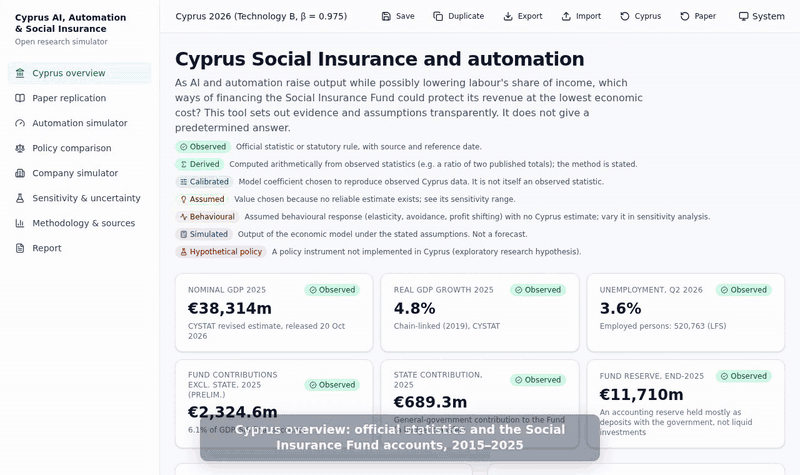
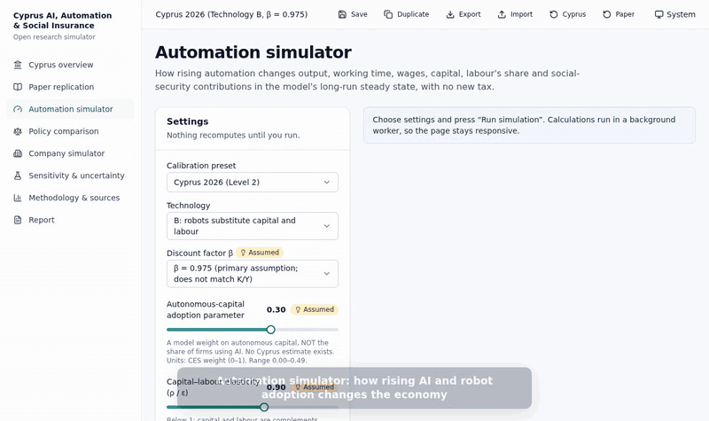
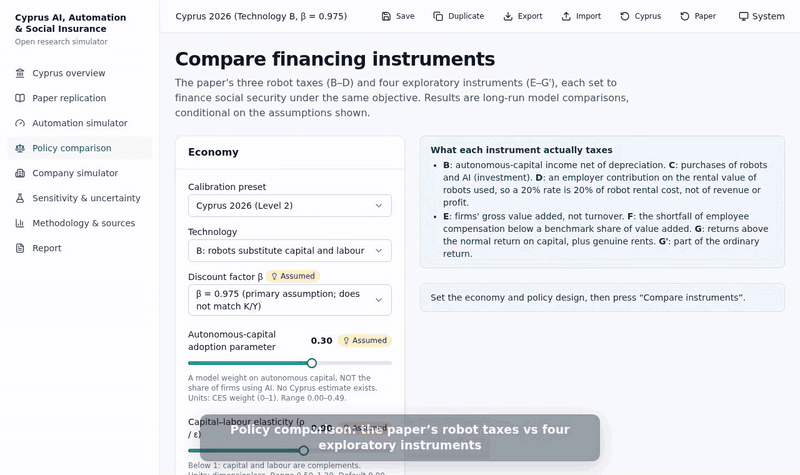
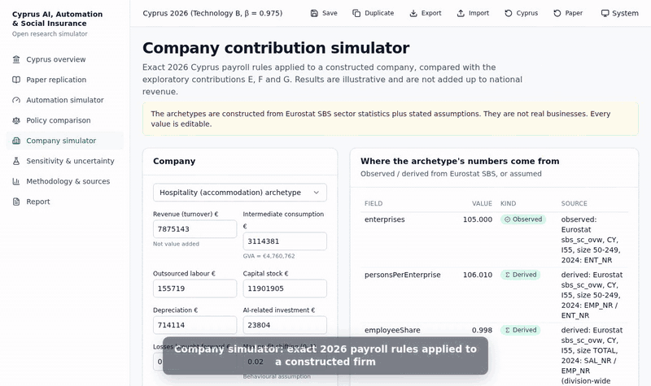
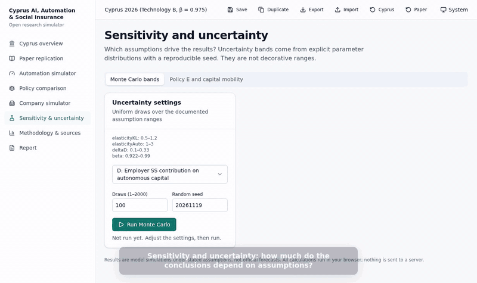
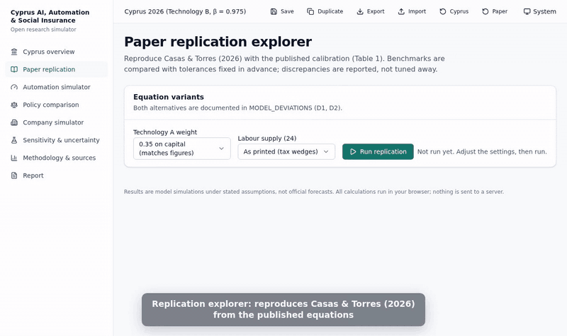
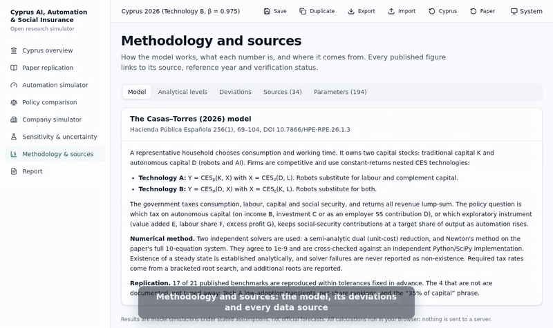
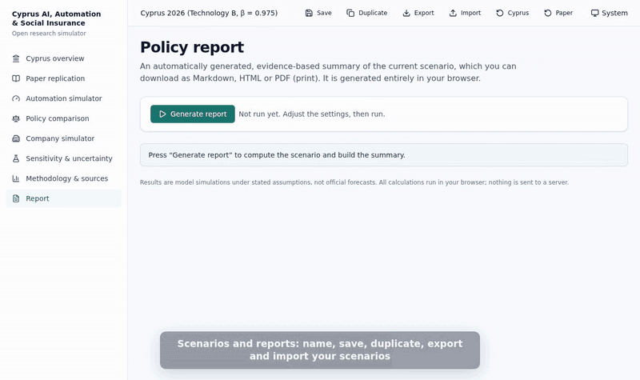

# Cyprus AI, Automation and Social Insurance simulator

A static, browser-only research simulator. It asks how Cyprus could finance its Social Insurance Fund if AI and automation reduce labour's share of income.

It replicates Casas & Torres (2026), *Automation, Taxation, and Social Security Sustainability*, Hacienda Pública Española 256(1):69–104 ([DOI 10.7866/HPE-RPE.26.1.3](https://doi.org/10.7866/HPE-RPE.26.1.3)). It then applies the model to a documented Cyprus calibration and compares the paper's robot taxes (B–D) with exploratory instruments E, F, G and G′.

Results are long-run model simulations under stated assumptions. They are not forecasts or official estimates. Every number in the interface is labelled observed, derived, calibrated, assumed, behavioural, simulated, or hypothetical policy.

## Demo

The GIFs are recorded with Playwright against the production build (`npm run demo:gifs`). All numbers are live model output, not mock-ups.

### Cyprus overview


Official CYSTAT and Social Insurance Services data for 2015–2025: Fund receipts by source against expenditure, and the 2026 statutory rules, each linked to its source. Every value carries a provenance label.

### Automation simulator


Set the autonomous-capital adoption parameter and the elasticities, then solve the long-run steady state in a Web Worker. Without new instruments, social-security contributions fall below the Fund's financing target as adoption rises, and labour's share of income falls.

### Policy comparison


Each instrument's rate is solved to restore the same financing target. Failures are flagged: the neutral excess-profit contribution G raises nothing without economic rents. Real effects, distribution and efficiency are reported separately, with no single "winner" score.

### Company simulator


Exact 2026 Cyprus payroll rules (SI ceiling per employee and per period, GHS, other funds, income tax) applied to firm archetypes built from Eurostat business statistics. Contributions are compared with E, F and G, a reason is given for each, and the provenance of every input is shown.

### Sensitivity and uncertainty


Monte Carlo bands over uncertain parameters, and structural scenarios. Rankings can reverse: value-added contribution E is the cheapest per € raised in the long run, but the most costly when capital is fixed.

### Paper replication


Casas & Torres (2026) recomputed from the published equations: 17 of 21 benchmarks reproduced. The four discrepancies are documented rather than tuned away, and each equation variant can be selected.

### Methodology and sources


The model, every deviation from the printed paper, a searchable list of all Cyprus parameters, and official sources with retrieval dates and file hashes.

### Scenarios and reports


Name, save, duplicate, export and import scenarios; they are stored only in your browser. Generate a report as Markdown, HTML or PDF. Light and dark themes are available, and the app is keyboard accessible and works on mobile.

## Privacy

All computation runs in your browser, in a Web Worker. There is no backend, analytics, telemetry or cookies. Saved scenarios are kept only in your browser's `localStorage`.

## Development

Requires Node 24 (see `.nvmrc`).

```sh
npm ci
npm run dev          # local development server
npm test             # unit, property, differential and regression tests (Vitest + fast-check)
npm run test:e2e     # Playwright against the production build under /candt4cyprus/
npm run build        # static build in dist/
npm run demo:gifs    # re-record the README demo GIFs (needs ffmpeg)
```

Correctness checks:

- `npm run oracle`: an independent Python/SciPy implementation, used only in development and CI.
- `npm run test:mutation`: Stryker mutation testing.
- `npm run data:validate`: checks provenance and schemas for every Cyprus parameter.

## Documentation

- `docs/MODEL_SPEC.md`: the model equations and Propositions 1–3.
- `docs/MODEL_DEVIATIONS.md`: every deviation from the printed paper and every documented discrepancy.
- `docs/replication/REPLICATION_REPORT.md`: replication benchmarks.
- `docs/cyprus/CALIBRATION_REPORT.md` and `docs/cyprus/DATA_GAPS.md`: Cyprus data, sources and gaps.
- `docs/policies/POLICIES.md` and `docs/policies/POLICY_COMPARISON.md`: instruments E, F, G and G′ and their comparison.

## Data and licensing notes

- Cyprus data come from official public sources: CYSTAT, Social Insurance Services, Eurostat, and Cyprus legislation. Full provenance and hashes are in `src/data/sources.json`.
- The original SIS Word bulletins are not redistributed. Only the extracted figures, the extraction script and file hashes are committed.
- The paper's PDF (CC BY-NC) is not part of this repository.
- Code is released under the [MIT License](LICENSE).
